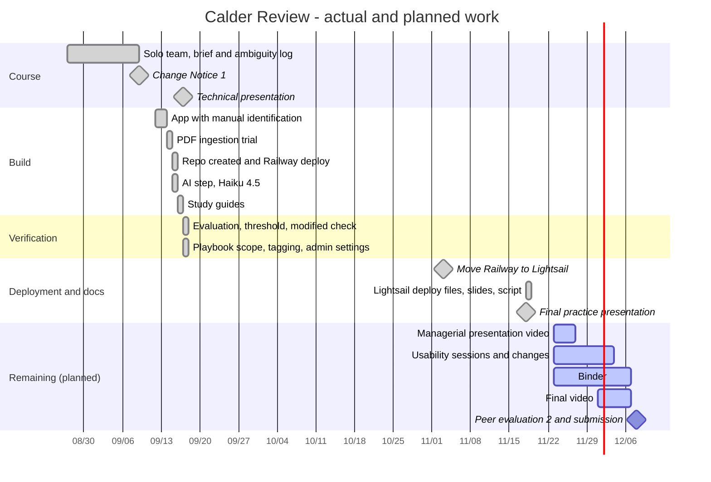

# 5. Project Planning and Scheduling

The schedule below was reconstructed in November from git commits, dated documents and syllabus deadlines. I did not keep a plan or task board during the semester. Where a date is uncertain it is marked.

## 5a. Work breakdown structure

Owner of every task: Matt Holliday (solo team). "Claude drafted" means Claude Code wrote the first version under my direction and I reviewed it.

1. **Project management**
   1.1 Read the brief; keep ambiguity log (18 entries). Claude drafted entries 9-18; Matt confirms.
   1.2 Change log, risk log, provenance log. Claude drafted; Matt confirms.
   1.3 Presentations: technical (17 Sep), managerial (7 Oct), final practice (18 Nov), final video
   1.4 Peer evaluations #1 (6 Oct) and #2 (8 Dec)
2. **Application build (manual identification first)**
   2.1 Data model, roles and permissions. Claude drafted.
   2.2 Intake and document upload. Claude drafted.
   2.3 Text extraction and clause splitting; ingestion trial on 30 CUAD PDFs (14 Sep). Claude drafted.
   2.4 Manual identification screen; flag generation. Claude drafted.
   2.5 Review queue, decisions with reasons, dispositions, history record. Claude drafted.
   2.6 Reports page. Claude drafted.
   2.7 Administrator screens: provisions, users, configuration. Claude drafted.
3. **AI and rules**
   3.1 Text rules for provisions. Claude drafted.
   3.2 AI identification step (Claude Haiku 4.5), failure handling. Claude drafted.
   3.3 Clause search, in-clause highlight tagging. Claude drafted.
4. **Verification (brief Section 6)**
   4.1 40-contract check set (6.1). Claude ran; spot-check of labels not done.
   4.2 Per-category evaluation of rules and AI (6.2). Claude ran and tabulated; Matt decided.
   4.3 Ten modified agreements (6.3). Claude drafted the files and ran them.
   4.4 Threshold note (6.4). Claude drafted; Matt decided the threshold.
5. **Deployment**
   5.1 Railway deployment (15 Sep), settings incident fixed
   5.2 Move to AWS Lightsail with Docker and HTTPS (3 Nov)
6. **Handoff documents**: README, runbook, known issues, playbook maintenance. Claude drafted.
7. **Usability sessions** (planned, not run)
8. **Binder and final video** (planned)

## 5b. Gantt chart

Notes on dates:
- 27 Aug: solo-team date from the risk log. [CONFIRM: when work on the project actually started, and when the brief froze (end of Week 2).]
- 12-14 Sep: from the commit message "Import the project as built so far (Sept 12-14)". [CONFIRM: whether work began before 12 Sep.]
- 17 Sep: technical presentation date as recorded in the repo. The syllabus lists 16 Sep. [CONFIRM: which.]
- Git shows no commits between 17 Sep and 18 Nov. [CONFIRM: what work happened in that period, such as the 7 Oct video, the 28 Oct sitrep and the Lightsail migration, and add bars if needed.]
- 3 Nov: Railway to Lightsail move. The deployment files were committed on 18 Nov.
- Remaining bars are plans, not records. [CONFIRM: dates for usability sessions, managerial video recording and final video.]
- Fixed dates: peer evaluation #1 due 6 Oct; peer evaluation #2 and the binder and final video due 8 Dec (binder by 10 pm). The syllabus has no class on the Thanksgiving week of 23 Nov.

## 5c. Task board
I did not keep an agile task board. [Matt: add screenshot if you create one.] The remaining-work list below is the current board.

| Task | Status |
|---|---|
| Run usability sessions with people outside the team (plan in `docs/usability-sessions.md`); record what I observed and changed | Not started |
| Record the managerial presentation video (script in `docs/managerial-presentation-script.md`) and upload to the eLC dropbox | Script written, not recorded |
| Spot-check labels against the CUAD Labeling Handbook (brief 6.1) | Not done |
| Check ambiguity log entries 9-18 and risk log ratings | Drafted, not confirmed |
| Update the deployment runbook, which still describes Railway | Not done |
| Write the binder (sections 1-14 of the syllabus outline) | In progress |
| Record the final presentation video | Not started |
| Peer evaluation #2 | Not started |

No sprint planning or burndown chart: there were no sprints.
