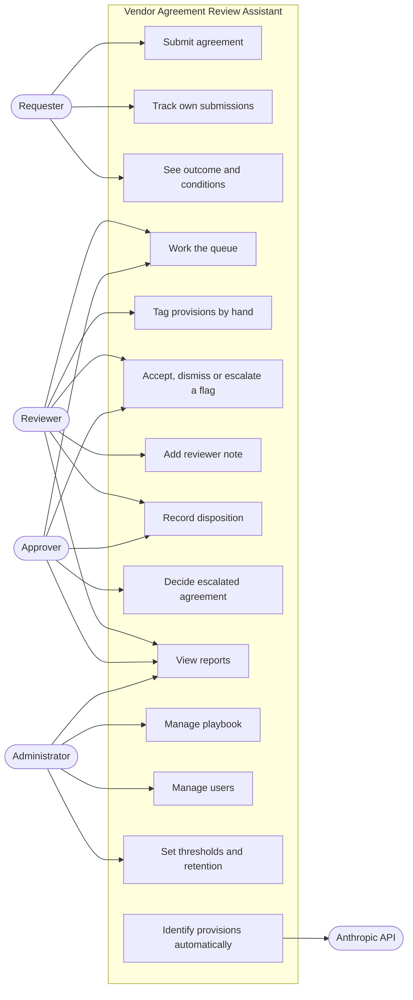
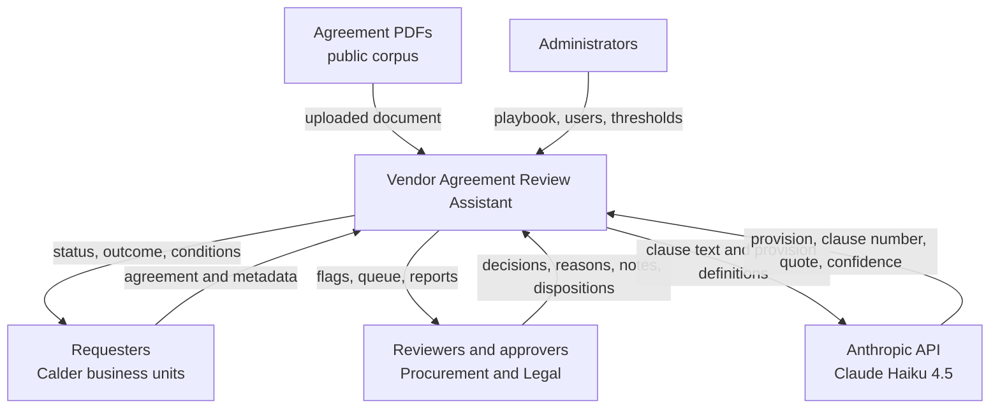
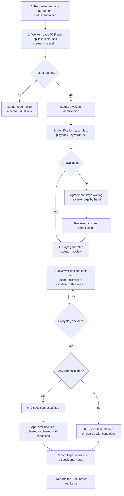
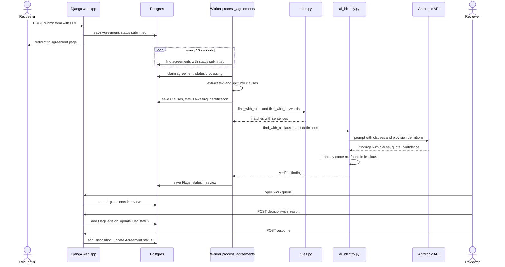
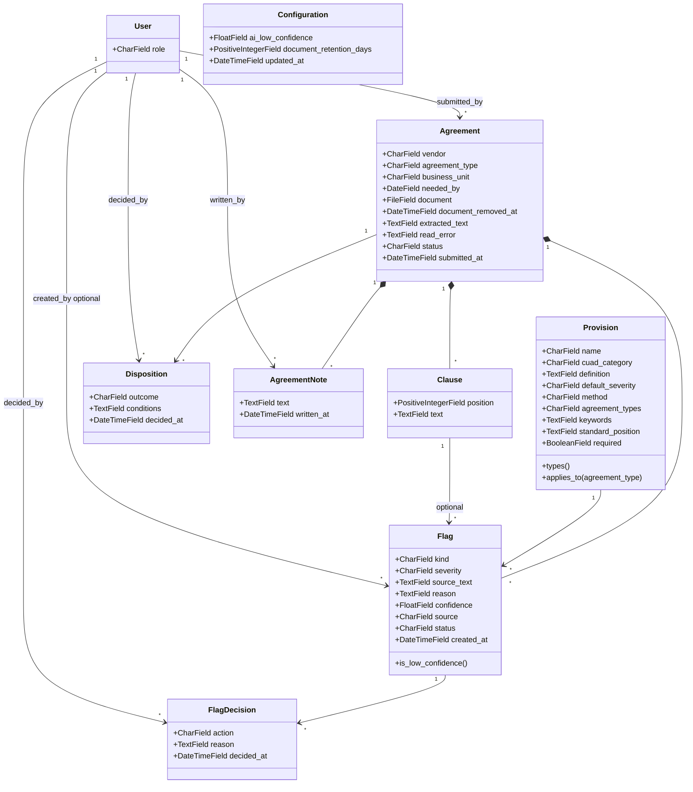
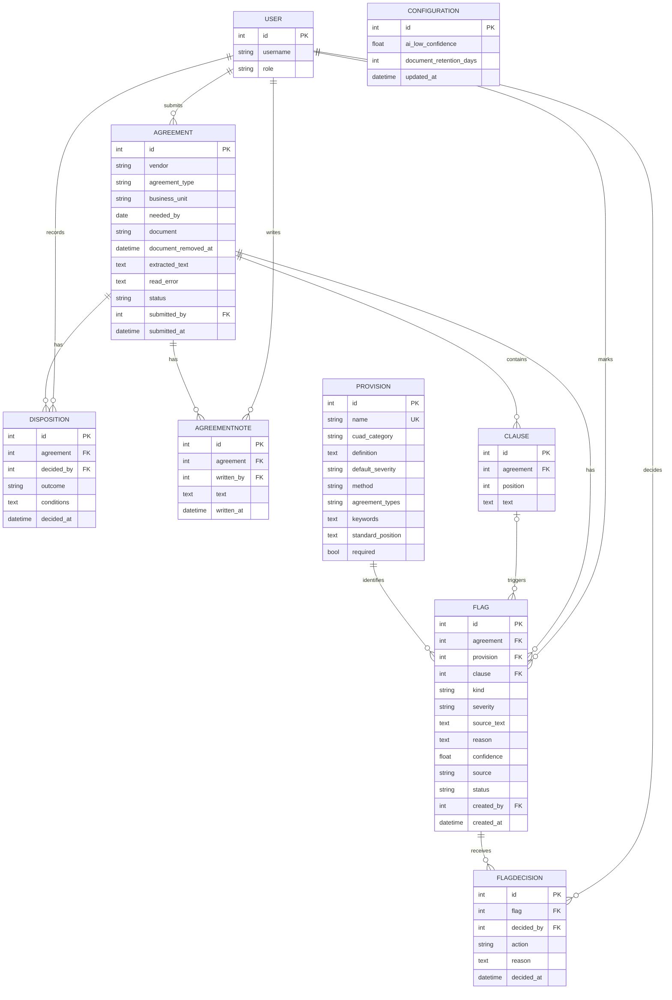

# 6. Requirements

## 6.1 How requirements were gathered

There were no client interviews. Calder Industrial Supply is a fictional client, so I had no one to interview. The requirements came from four written or instructor-supplied sources:

- **The project brief (v1)** and **Change Notice 1** (2026-09-09). The brief marks Sections 3, 4, 5, 6 and 9 as fixed. Change Notice 1 moved comparison to standard positions, deviation characterization and gap detection to stretch, and required that submission and analysis not run in the same request. I treat "Fixed" brief items as Must.
- **Instructor feedback at the 9/17 technical presentation.** He said the system "needed to make more decisions." He also asked for direct text markup. That produced the manual highlight-to-tag screen (REQ-24) and the rules, keyword and AI identification steps.
- **The ambiguity log** (`docs/ambiguity-log.md`, 18 entries). The brief lists eight open questions (Section 10). I decided each one and recorded the reasoning. Entries 9 to 18 came up while building. Several decisions became requirements, for example reviewer notes hidden from requesters, per-agreement-type playbooks, and document retention.
- **The syllabus**, for graded deliverables (presentations, binder, final video).

Requirement IDs below are mine. They follow the rows of `docs/requirements-checklist.md` (status as of 2026-09-17, with the deployment URL updated). The checklist has no stories, so I wrote the user stories from the brief's wording.

Test status key: **Unit** = automated tests in `core/tests.py`, `core/test_review.py`, `core/test_auto.py` (63 test methods; run with `python manage.py test`). **Eval** = measured on the 40-contract check set. **Manual** = I checked it by hand or in the demo. **None** = no check yet.

## 6.2 Traceability matrix

Brief section column: section of `MIST7590E_Project_Brief_v1.txt`, as amended by Change Notice 1 (CN1).

### Users, roles and permissions (brief Section 3, Fixed)

| ID | User story | Priority | Brief | Implemented in | Status | Test status |
|---|---|---|---|---|---|---|
| REQ-01 | As a requester, I want to submit an agreement and track my own submissions, so that I know where it stands. | Must | 3, 4.1 | `submit_agreement`, `my_submissions`, `agreement_detail` (`core/views.py`) | Done | Unit: `IntakeTests`. Manual demo |
| REQ-02 | As a requester, I want to see the outcome and any conditions, so that I know what I may do next. | Must | 3 | `agreement_detail` | Done | Unit: `test_the_requester_sees_the_outcome_and_conditions_but_not_the_findings`. Manual demo |
| REQ-03 | As a reviewer, I want to work a queue of agreements, so that I know what to review next. | Must | 3 | `work_queue`, Work queue screen | Done | Unit: `test_the_work_queue_is_for_staff_only`. Manual demo |
| REQ-04 | As a reviewer, I want to accept, dismiss or escalate each flag with a reason, so that every decision is explained. | Must | 3, 4.7 | `core/review.py` `record_decision`, `decide_flag`, review page | Done | Unit: `test_a_decision_records_who_what_and_why`, `test_a_decision_needs_a_reason`, `test_changing_a_decision_keeps_the_earlier_one` |
| REQ-05 | As a reviewer, I want to add notes to an agreement and complete the review, so that my reasoning is kept. | Must | 3 | `add_note`, `dispose`, review page (notes added 2026-09-17) | Done | Unit: `test_a_reviewer_adds_a_note_and_a_requester_never_sees_it` |
| REQ-06 | As an approver, I want everything a reviewer can do plus the final disposition on escalated items, so that escalations are resolved by someone with authority. | Must | 3 | `core/permissions.py` `can_review`, `core/review.py` `allowed_outcomes` | Done | Unit: `test_only_the_approver_decides_an_escalated_agreement`, `test_an_escalated_finding_means_the_agreement_is_escalated` |
| REQ-07 | As an administrator, I want to manage the playbook, users and thresholds, and reach reporting, so that I can run the system without a developer. | Must | 3 | Django admin: Provisions, Users, Configuration (`core/admin.py`); `core/config.py` | Done | Unit: `AdministratorSettingsTests` (threshold setting). Manual demo for the admin screens |
| REQ-08 | As Calder, I want documents and review notes kept private and every page behind a login, so that contracts are not exposed. | Must | 3 | `@login_required` and `role_required` on views; `agreement_document` checks permission | Done | Unit: `test_pages_past_the_landing_page_need_a_login`, `test_requesters_cannot_open_someone_elses_agreement` |
| REQ-09 | As a reviewer, I do not want to review an agreement I submitted, so that review is independent. | Must (my rule; the brief gives no explicit rule) | 3 | `core/permissions.py` `can_review` | Done | Unit: `test_nobody_reviews_an_agreement_they_submitted` |

### Core workflow (brief Section 4, as amended by CN1, Fixed)

| ID | User story | Priority | Brief | Implemented in | Status | Test status |
|---|---|---|---|---|---|---|
| REQ-10 | As a requester, I want to enter vendor, agreement type, business unit, needed-by date and upload the document, so that the agreement enters review. | Must | 4.1 | `submit_agreement`, `core/forms.py`, Submit screen | Done | Unit: `test_submitting_saves_the_agreement_without_reading_it`, `test_a_renamed_file_that_is_not_a_pdf_is_rejected`, `test_a_past_needed_by_date_is_rejected` |
| REQ-11 | As a reviewer, I want the document read and split into clauses without slowing the web page, so that large PDFs never hang the site. | Must | 4.2, CN1 | `core/reading.py`; worker `process_agreements --watch` | Done | Unit: `ReadingTests`, `SplittingTests` (14 tests). Manual: PDF ingestion trial 2026-09-14 (`docs/ingestion-trial-2026-09-14.txt`) |
| REQ-12 | As a reviewer, I want a clear failure reason when a document cannot be read, so that I can act on it. | Must | 4.2 | `reading.mark_failed`, status `read_failed` | Done | Unit: `test_a_pdf_with_no_text_fails_with_a_reason`, `test_a_damaged_pdf_fails_with_a_reason` |
| REQ-13 | As a reviewer, I want each clause checked against the playbook, so that relevant provisions are found. | Must | 4.3 | `core/auto_identify.py`, `core/rules.py`, `core/ai_identify.py`, manual screen | Done | Unit: `core/test_auto.py` (`RuleTests`, `AIStepTests`, `AutomaticIdentificationTests`). Eval: `docs/evaluation-*.md` |
| REQ-14 | As a reviewer, I want each flag to show provision, severity, exact source text, reason and confidence, so that I can judge it. | Must | 4.6 | `Flag` model; review page | Done | Unit: `test_the_database_refuses_a_confidence_above_one`, `test_the_supporting_words_are_marked_even_across_a_line_break` |
| REQ-15 | As a reviewer, I want the review to be complete only after every flag is decided, so that nothing is skipped. | Must | 4.7, 4.8, ambiguity 8 | `core/review.py` `record_disposition` | Done | Unit: `test_the_outcome_waits_until_every_finding_is_decided` |
| REQ-16 | As a reviewer or approver, I want to record cleared, cleared with conditions or escalated, so that the agreement has an outcome. | Must | 4.8 | `core/review.py` `record_disposition`, `dispose` | Done | Unit: `test_clearing_with_conditions_needs_the_conditions` and the other `ReviewTests` |
| REQ-17 | As an auditor, I want all decisions and outcomes kept and retrievable, so that I can see who decided what and why. | Must | 4.9 | Add-only `FlagDecision`, `Disposition`, `AgreementNote`; `audit_history`; History table | Done | Unit: `test_changing_a_decision_keeps_the_earlier_one`, `test_a_finding_with_decisions_cannot_be_deleted` |
| REQ-18 | As Procurement or Legal, I want aggregate reporting, so that I can see volume, waiting time and common provisions. | Must | 4.10 | `reports`, Reports screen: waiting by stage, turnaround, provisions found most often | Done | Unit: `test_reports_count_the_provisions_found_and_are_for_staff_only`. Manual demo |
| REQ-19 | As a reviewer, I want comparison to standard positions, deviation characterization and gap detection. | Could (stretch after CN1) | 4.4, 4.5, CN1 | Fields `standard_position`, `required`, `Flag.Kind` deviation and gap exist; not used | Not done (out of required scope) | None |

### The AI component (brief Section 5, as amended, Fixed)

| ID | User story | Priority | Brief | Implemented in | Status | Test status |
|---|---|---|---|---|---|---|
| REQ-20 | As a reviewer, I want the AI to identify which playbook provisions appear, so that I do not search by eye. | Must | 5 | `core/ai_identify.py` (Claude Haiku 4.5), eight of ten categories | Done | Eval: `docs/evaluation-ai-2026-09-17.md`. Unit: `AIStepTests` (model call mocked) |
| REQ-21 | As a reviewer, I want each AI finding to quote the contract, so that I can verify it. | Must | 5 | Quote checked against the clause; unverifiable quotes dropped | Done | Unit: `AIStepTests`; `test_words_that_are_not_in_the_clause_are_rejected` covers the manual path. Eval |
| REQ-22 | As a reviewer, I want a confidence value with each AI finding, so that I can weigh it. | Must | 5 | `Flag.confidence` (0 to 1, database constraint) | Done | Unit: `test_the_database_refuses_a_confidence_above_one` |
| REQ-23 | As Calder, I want no chat interface, drafting, redlining or AI-only disposition, and nothing untraceable to source text, so that people stay in control. | Must | 5 | None of these exist; every disposition is recorded by a signed-in person | Done | Manual: no such view or URL exists (`core/urls.py`) |
| REQ-24 | As a reviewer, I want to highlight text and tag a provision myself, so that the app still works without the AI and I can mark what automation missed. | Must (architectural test, Section 5; also instructor request 9/17) | 5 | `identify`, `add_missed_finding`, `save_manual_finding`, Identify screen | Done | Unit: `test_a_reviewer_can_mark_a_provision_with_its_exact_words`, `test_a_reviewer_can_add_a_finding_identification_missed`, `test_the_identification_page_offers_tagging` |
| REQ-25 | As a reviewer, I want the app to keep working if the AI fails, so that one outage does not stop reviews. | Must | 5 | `AIUnavailable` handling in `auto_identify.py`; agreement stays waiting for a person | Done | Unit: `AutomaticIdentificationTests`. Manual |
| REQ-26 | As a reviewer, I want low-confidence findings marked and listed last, so that they get attention without being hidden. | Must | 5, ambiguity 4 | `Flag.is_low_confidence`, `Configuration.ai_low_confidence` (0.9); `docs/threshold-note.md` | Done | Unit: `test_the_threshold_comes_from_the_administrator_setting` |

### Checking that it works (brief Section 6, Fixed)

| ID | User story | Priority | Brief | Implemented in | Status | Test status |
|---|---|---|---|---|---|---|
| REQ-27 | As the sponsor, I want a check set of at least 30 contracts covering the chosen categories. | Must | 6.1 | 40 contracts, `seed/check_set.txt`; 12+ examples per category | Done | Eval (`core/cuad.py`, `count_categories` command) |
| REQ-28 | As the sponsor, I want the labels spot-checked against the Labeling Handbook, with what surprised me noted. | Must | 6.1 | Not started | Not done | None |
| REQ-29 | As the sponsor, I want two numbers per category for each method, and no single overall accuracy figure. | Must | 6.2 | `evaluate_identification` command; `docs/evaluation-rules-*.md`, `docs/evaluation-ai-2026-09-17.md` | Done | Eval (the evaluation is the test) |
| REQ-30 | As the sponsor, I want to know which categories are handled reliably and which are not, and why. | Must | 6.2 | `docs/verification.md` | Done | Eval |
| REQ-31 | As the sponsor, I want ten deliberately modified agreements tested, to see whether performance holds. | Must | 6.3 | `seed/modified_agreements/`, `evaluate_modified` command, `docs/evaluation-modified-2026-09-17.md`, `docs/verification.md` | Done | Eval |
| REQ-32 | As the sponsor, I want a one-to-two page threshold note answering four questions. | Must | 6.4 | `docs/threshold-note.md` | Done | Manual review by me |

### Scope (brief Section 8)

| ID | User story | Priority | Brief | Implemented in | Status | Test status |
|---|---|---|---|---|---|---|
| REQ-33 | As a requester, I want to upload PDFs and have the text extracted. | Must | 8 | `core/reading.py` `extract_text` | Done | Unit: `ReadingTests` |
| REQ-34 | As a reviewer, I want clauses segmented. | Must | 8 | `core/reading.py` `split_into_clauses` | Done | Unit: `SplittingTests` |
| REQ-35 | As an administrator, I want a defined playbook subset with a reason for each category. | Must | 8 | Ten categories in `Provision`; `docs/playbook-selection.md`; `load_playbook` command | Done | Eval; manual |
| REQ-36 | As Calder, I want a per-agreement-type playbook. | Should (ambiguity 3) | 10 | `Provision.agreement_types`, `applies_to` | Done | Unit: `AutomaticIdentificationTests` [CONFIRM: that a test covers type scoping specifically] |
| REQ-37 | As an administrator, I want my own keywords added to the text pass. | Could | 3 (configure) | `Provision.keywords`, `rules.find_with_keywords` | Done | Unit: `RuleTests`, `AutomaticIdentificationTests` [CONFIRM: keyword path covered] |
| REQ-38 | As Calder, I want the app deployed at a URL with demo data and an account for each role. | Must | 8, 9 | Lightsail, https://calder.100-59-211-221.nip.io; `seed_demo` command; four demo logins | Done | Manual: deployed 2026-11-03 (Railway before that, 2026-09-15) |
| REQ-39 | As Calder, I want verification results per Section 6. | Must | 8 | `docs/verification.md` | Partial | Only the 6.1 label spot-check (REQ-28) is outstanding |

### Technical constraints (brief Section 9, Fixed)

| ID | User story | Priority | Brief | Implemented in | Status | Test status |
|---|---|---|---|---|---|---|
| REQ-40 | As the sponsor, I want a web app on a public URL well before the final presentation. | Must | 9 | Deployed 2026-09-15; moved to Lightsail 2026-11-03 | Done | Manual |
| REQ-41 | As the sponsor, I want persistent storage with a defined schema. | Must | 9 | Postgres; `core/models.py` and migrations | Done | Unit: Django test database runs all migrations |
| REQ-42 | As the sponsor, I want source control from Week 2. | Must | 9 | Repository created 2026-09-15 (missed; recorded in `docs/risk-log.md`) | Partial (missed deadline) | n/a |
| REQ-43 | As the sponsor, I want no real personal data or proprietary contracts. | Must | 9 | Public corpus only | Done | Manual |
| REQ-44 | As the sponsor, I want API keys in environment variables, never in the repository. | Must | 9 | `ANTHROPIC_API_KEY` read from the environment; `/opt/calder/.env` on the server | Done | Manual [CONFIRM: no key was ever committed, or it was rotated and logged] |
| REQ-45 | As the sponsor, I want a rule-or-model decision per category, with measurements. | Must | 9 | `docs/playbook-selection.md`; `Provision.method` | Done | Eval |
| REQ-46 | As the sponsor, I want PDF ingestion proven early. | Must | 9 | Trial 2026-09-14 | Done | Manual (`docs/ingestion-trial-2026-09-14.txt`) |
| REQ-47 | As an administrator, I want old documents deleted after a retention period while the review record stays. | Should (ambiguity 5) | 10 | `Configuration.document_retention_days`, `purge_documents` command, `Agreement.document_removed_at` | Done | Unit: `test_documents_are_deleted_only_after_the_retention_period` |

### Ambiguity log, governance and AI use (brief Sections 10 to 12)

| ID | User story | Priority | Brief | Implemented in | Status | Test status |
|---|---|---|---|---|---|---|
| REQ-48 | As the sponsor, I want an ambiguity log: question, options, decision, reasoning, consequence. | Must | 10 | `docs/ambiguity-log.md`, 18 entries | Done | Manual. Entries 9 to 18 and the risk-log judgments were drafted by AI and need my confirmation [CONFIRM] |
| REQ-49 | As the sponsor, I want usability sessions with people outside the team before 10/7. | Must | 11 | `docs/usability-sessions.md` (plan only) | Not done | None. No sessions were held |
| REQ-50 | As the sponsor, I want what I observed in the sessions and what I changed documented. | Must | 11 | Template only | Not done | None (depends on REQ-49) |
| REQ-51 | As a new developer, I want a README for setup from a clean machine, with seed data and a path to a local instance. | Must | 11 | `README.md`, `seed_demo` | Done | Manual |
| REQ-52 | As an operator, I want a deployment runbook. | Must | 11 | `docs/deployment-runbook.md`, `deploy/lightsail/README.md` | Done | Manual (used for the 11-03 move) |
| REQ-53 | As the sponsor, I want an honest known-issues list. | Must | 11 | `docs/known-issues.md` | Done | Manual |
| REQ-54 | As an administrator, I want playbook maintenance instructions. | Must | 11 | `docs/playbook-maintenance.md` | Done | Manual |
| REQ-55 | As the sponsor, I want a component provenance log, one row per module. | Must | 12 | `docs/provenance-log.md` | Done | Manual |
| REQ-56 | As the sponsor, I want the author to explain any file the instructor opens, including malformed input. | Must | 12 | Study guides (`docs/study-guide-1-web-app.md`, `docs/study-guide-2-pipeline.md`), `docs/code-walkthrough.md` | Partial: written; my own understanding is what is graded | None |

Not built, by decision: standard positions and deviation characterization, gap detection, playbook versioning, clause-level comments, vendor history, bulk intake (stretch); negotiation, e-signature, vendor master data, live Calder integration, mobile apps, multi-tenancy, non-English agreements (out of scope).

Summary: 56 rows. Not done: REQ-19 (stretch), REQ-28, REQ-49, REQ-50. Partial: REQ-39, REQ-42, REQ-56.

## 6.3 Use case diagram

Mermaid has no UML use case type, so this is a flowchart: actors on the left, use cases on the right. An approver also performs every reviewer use case.

## 6.4 Context diagram

## 6.5 Process diagram: review workflow

This follows the workflow as amended by Change Notice 1. Comparison and gap detection are not shown because they were moved to stretch.

## 6.6 Sequence diagram: submit to review

## 6.7 Class diagram

Derived from `core/models.py`. `User` extends Django's `AbstractUser`.

The review logic lives in modules, not model classes: `core/review.py` (decisions, dispositions, allowed outcomes), `core/permissions.py` (`can_view_agreement`, `can_review`, `role_required`), `core/reading.py`, `core/rules.py`, `core/ai_identify.py`, `core/auto_identify.py`.

## 6.8 Data model (ER diagram)

Seven tables in `core/models.py`, plus the user table. `Configuration` is a single row. `FlagDecision`, `Disposition` and `AgreementNote` are add-only. `Flag.clause` uses SET_NULL; decisions use PROTECT, so a flag with a decision cannot be deleted.

Database constraint: `flag_confidence_between_0_and_1` on `Flag.confidence`.
