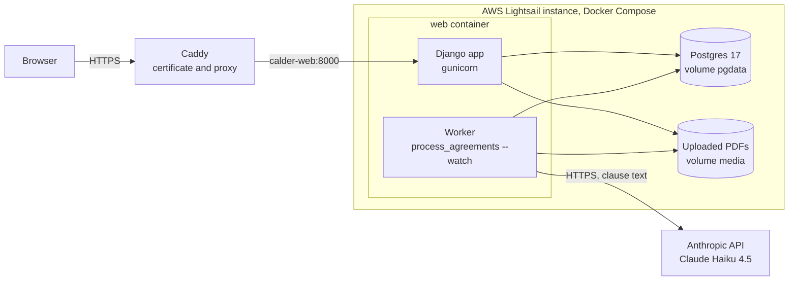
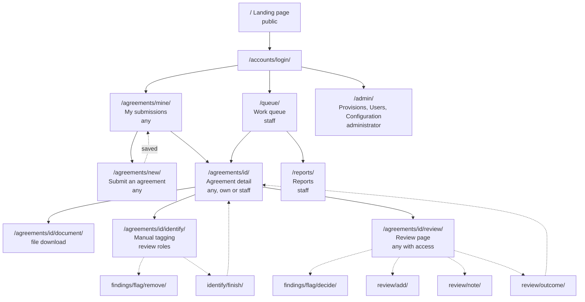

# 7. Design

## 7.1 System architecture

The system is one Django web application and one background worker that share a Postgres database. The web app never reads a document itself. Submitting saves the file and a row; the worker does the slow reading and identification afterward (Change Notice 1: submission and analysis cannot share a request).

| Component | What it does | Where |
|---|---|---|
| Browser | Server-rendered HTML pages, no separate front-end app. The manual tagging screen uses a little JavaScript for text selection. | Users' machines |
| Django 6 web app (gunicorn) | Login, roles, intake, queue, review, tagging, reports, document download. Views in `core/views.py`, permission rules in `core/permissions.py`, decision rules in `core/review.py`. Admin screens use Django admin. | `web` container |
| Postgres 17 | All tables in `core/models.py`. Uploaded PDFs are not in the database; they sit on a Docker volume. | `db` container, volume `pgdata` |
| Background worker | `python manage.py process_agreements --watch`. Every 10 seconds it picks up agreements with status "submitted", reads the PDF (`core/reading.py`), splits it into clauses, then runs identification (`core/auto_identify.py`). | Same `web` container as a second process, started by `start.sh` |
| Text rules | Regular-expression rules for categories where text rules measured well, plus administrator keywords (`core/rules.py`). | In-process |
| AI step | Sends clause text and provision definitions to Claude Haiku 4.5 and checks that each returned quote appears in its clause (`core/ai_identify.py`). | Outbound HTTPS to the Anthropic API |
| File storage | Uploaded PDFs, with a retention rule run by `purge_documents`. | Docker volume `media` |
| Hosting | AWS Lightsail instance, Docker Compose (`deploy/lightsail/docker-compose.yml`). The Caddy server already on the box terminates HTTPS and forwards `calder.100-59-211-221.nip.io` to `calder-web:8000`. Secrets are in `/opt/calder/.env`, not in Git. Deploy with `bash deploy/lightsail/deploy.sh`. | Lightsail, since 2026-11-03 |

Design decisions that shape the architecture:

- **Worker separate from requests.** A large or damaged PDF cannot hang the submit page. An agreement is claimed once, so two workers cannot read the same one (`test_an_agreement_is_only_read_once`).
- **The AI is optional.** If the API fails, the agreement stays "waiting for identification" and a reviewer tags provisions by hand. Remove the AI and the application still works (brief Section 5, architectural test).
- **Every finding quotes the contract.** The AI's quote is checked against the clause; a quote that is not there is dropped.
- **Add-only audit record.** Decisions, dispositions and notes are only added. Database rules (PROTECT) stop deletion of a flag that has a decision.
- **Roles enforced on the server.** Each view is wrapped in `login_required` or `role_required`; the UI hides links, but the check is in the view.

## 7.2 Site map

Built from `config/urls.py` and `core/urls.py`. Solid arrows are links a user follows; the dotted ones are form submissions that redirect back. Access: Public = no login, Any = any signed-in role (requesters see only their own agreements), Staff = reviewer, approver, administrator, Review = reviewer or approver.

The review page returns 403 unless `can_review` is true: the user is a reviewer or approver (an approver only for escalated agreements), the agreement is in a reviewable status, and the user did not submit it. Requesters see the outcome and conditions on the detail page, not the findings.

## 7.3 Wireframes

I did not draw separate mock-ups. Each entry below describes the layout of the built screen, taken from the templates in `core/templates/`. Every page shares one layout from `base.html`: a header with the site name and the university logo, a navigation bar, the page content, and a footer. The navigation shows "Work queue" and "Reports" for staff, "Submit an agreement" and "My submissions" for everyone signed in, and "Log in" or "Log out".

Screenshots are to be taken from a local or demo instance by me, not by the drafting tool.

### Landing and login (`home.html`, `registration/login.html`)
Short heading, "Vendor agreement review", one line saying what the site is, and a "Log in" button. The login page is a username and password form.

[Screenshot: Landing and login]

### Submit an agreement (`submit.html`)
One form: vendor, agreement type (a list of six types), business unit, needed-by date, and a PDF file picker, then a "Submit" button. A past date or a file that is not a PDF is rejected with a message next to the field. After saving, the user goes to the agreement page and the worker reads the file in the background.

[Screenshot: Submit an agreement]

### My submissions (`my_submissions.html`)
A table with columns Vendor, Type, Needed by, Submitted and Status. The vendor links to the agreement page. A link to "Submit an agreement" sits above the table.

[Screenshot: My submissions]

### Agreement detail (`agreement_detail.html`)
Vendor name as the heading, then a block of facts: status, agreement type, business unit, needed-by date, submitted by, and an "Open the file" link. Staff see links to "Identify provisions in this agreement" and "Review the findings and record the outcome". Below: the outcome (and conditions), a Findings table (provision, severity, clause, supporting text, found by, status), Notes, a History table (when, who, what, reason or conditions), and the clauses with a search box. A requester sees the outcome and conditions but not the findings or notes.

[Screenshot: Agreement detail]

### Work queue (`queue.html`)
Heading "Work queue", then one section per stage with a count, for example "In review (3)". Each section is a table: vendor, type, business unit, needed by, and how long the agreement has waited. Staff only.

[Screenshot: Work queue]

### Review page (`review.html`)
Heading "Review: vendor". A line at the top linking back to the agreement details. Then one card per finding: provision name (marked if low confidence), severity, the supporting text shown highlighted in its clause [CONFIRM: highlight placement on screen], the reason, a choice of accept, dismiss or escalate, a reason box and a "Record decision" button. Below the findings: Notes with an "Add note" box, "Add a finding identification missed" (a form to add one by hand), and "Outcome for the agreement" with the allowed outcomes, a conditions box and "Record outcome". The outcome is refused until every finding is decided.

[Screenshot: Review page]

### Manual tagging (`identify.html`)
Heading "Identify provisions: vendor". The left side lists the clauses ("Clauses (n)"). I select words in a clause, and a small panel offers "This is" with a provision list and an "Add finding" button (or "Cancel"). An "Add a finding" form is the fallback without JavaScript. "Findings so far (n)" lists what is marked, each with a "Remove" button. At the bottom, "Finish identification and send to review". Removal is possible only before review starts.

[Screenshot: Manual tagging]

### Reports (`reports.html`)
Heading "Reports". First table, "Agreements waiting, by stage": stage, agreements, median days waiting, longest wait in days. A turnaround figure (median days from submission to first outcome). Second table, "Provisions found most often": provision, times found, agreements, accepted, dismissed, escalated. Staff only.

[Screenshot: Reports]

### Administration (Django admin at `/admin/`)
Django's built-in admin screens, not custom pages. Provisions: list with a form for name, definition, severity, method, agreement types and keywords. Users: list and form with a role field. Configuration: one form with the AI low-confidence threshold and the document retention period. Agreements and flags can be viewed there; the decision, disposition and note tables are registered for inspection.

[Screenshot: Administration, Provisions list]
[Screenshot: Administration, Configuration]
